# Madhyam (माध्यम) – IPTV Player

  

  
  
  
  
  

⬇️ **[Download](#download)** | 📺 **[Free TV](#free-tv-comes-preinstalled)** | 🗺️ **[Platforms](#platforms)** | ☕ **[Buy me a coffee](https://buymeacoffee.com/diwaskhadka)**

**Madhyam** is a free IPTV player for **Windows** and **Android TV / Google TV**. It plays M3U / M3U8 playlists and Xtream Codes accounts, with a TV guide (EPG), movies, series, favorites and continue-watching. One version number covers every platform, and both apps are built on the same fast Rust engine.

> [!TIP]
> **Free TV comes preinstalled.** Open the app for the first time and thousands of free, public channels are already there, sorted by category and by country. No account and no playlist needed.

⚠️ Madhyam is a **player**. It does not sell subscriptions, channels or playlists. Free TV lists publicly available streams collected by the [iptv-org](https://github.com/iptv-org/iptv) project. Channels and pictures in the screenshots are for demonstration only.

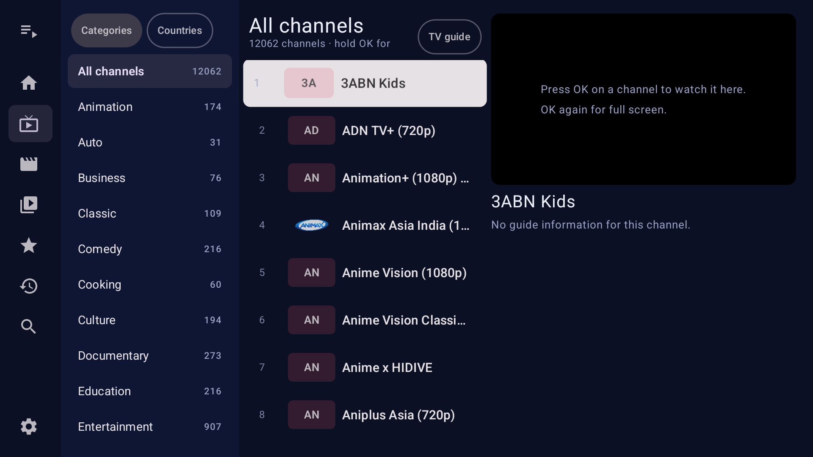

## Free TV comes preinstalled

- On first start, Madhyam adds a **Free TV** playlist with **12,000+ free channels** from [iptv-org](https://github.com/iptv-org/iptv).
- Browse it by **category** (News, Kids, Sports, Movies…) or by **country**, and hide the countries you don't need.
- It's an ordinary playlist: refresh it, hide categories, add favorites, or turn it off in **Settings**. Once you've turned it off, it stays off.
- Add your own Xtream Codes account or M3U playlist next to it at any time.

## Features

**Playlists & sources**

- Xtream Codes accounts and M3U / M3U8 playlists from a URL, as many as you like, with a playlist switcher
- Free TV (iptv-org) preinstalled, by category or by country
- Custom User-Agent per playlist, and a **Test connection** check
- Playlist and OpenSubtitles passwords stored encrypted (Android Keystore / Windows DPAPI)
- Offline start: the catalog is cached, so the app opens instantly

**Live TV & guide**

- Categories and channels with now / next, plus a live preview that keeps playing in full screen
- Channel zapping with ▲ / ▼ (remote) or Page Up / Page Down (keyboard)
- **TV guide** (XMLTV / EPG) grid, with a guide time offset and extra guide URLs
- **Catch-up** of past programmes on Xtream archive channels _(Android TV)_
- Live stream format: Auto, MPEG-TS or HLS

**Movies & series**

- Poster grids with sort and minimum-rating filters, and adjustable cover size
- Details pages with backdrop, plot and cast, **IMDb** and **Rotten Tomatoes** ratings (your own free OMDb key), and trailers
- Seasons and episodes with watched marks, resume, and **Continue watching**

**Player**

- Audio track and subtitle choice, with preferred languages
- **OpenSubtitles** search and download (your own API key)
- Audio delay and subtitle delay, playback speed, picture size, buffer size

**Home & organisation**

- Home page with a continue-watching banner and rows of favorites, recent channels and recently added
- Favorites, watch history and global search across Live TV, movies and series
- Hide categories and choose their order (provider, A–Z, Z–A)
- Themes: **Navy & Crimson** (dark), light, follow the system, or **Custom**: pick any colour (presets like Crimson, Royal blue and Teal, or your own) and the whole theme is built from it

## Download

Every platform is in the [latest release](https://github.com/diwaskhadka/Madhyam/releases/latest) under the same version number:

| Platform | File | Install |
|---|---|---|
| 🪟 **Windows 10 / 11** (64-bit) | `Madhyam-Setup-X.Y.Z.exe` | Run it. It installs for your account (no admin needed) and upgrades in place, keeping your playlists. Windows may say "Windows protected your PC" because the app isn't code-signed yet: click **More info › Run anyway**. |
| 📺 **Android TV / Google TV** (Android 5+) | `Madhyam-vX.Y.Z-androidtv.apk` | Sideload it, for example with *Send Files to TV* or `adb install`. Newer versions install over it and keep your playlists. |

Download only from [GitHub Releases](https://github.com/diwaskhadka/Madhyam/releases). What changed on each platform: [CHANGELOG.md](CHANGELOG.md).

## Platforms

| Platform | Status |
|---|---|
| 🪟 Windows 10 / 11 | ✅ Available |
| 📺 Android TV / Google TV | ✅ Available |
| 📱 Android phones and tablets | 🛠️ In the pipeline |
| 🍎 macOS, iPhone / iPad and Apple TV | 🛠️ In the pipeline |
| 🐧 Linux | 🛠️ In the pipeline |
| 🌐 Web | 🛠️ In the pipeline |

More platforms are on the way and will be released in future versions. The engine underneath is already cross-platform (Windows, macOS, Linux, Android), so each new app reuses it, and every platform ships in the same release with the same version number.

## Remote control and keyboard

**Android TV remote**

| Button | Action |
|---|---|
| OK | Play the channel in the preview, OK again for full screen; in the player, open the options row |
| Hold OK | Add or remove a favorite |
| ▲ / ▼ in the player | Previous / next channel |
| Menu | Player options |
| Play / Pause, ⏪ / ⏩ | Pause, seek 30 s back / forward |
| Back | Close the player or go back |

**Windows keyboard**

| Shortcut | Action |
|---|---|
| `Ctrl+K` / `Ctrl+F` | Search |
| `Space` | Play / pause |
| `F11` | Full screen; `Esc` leaves it |
| `←` / `→` | Seek 10 s (`Ctrl+←` / `Ctrl+→` outside full screen) |
| `↑` / `↓` | Volume (films); previous / next channel (live, full screen) |
| `Page Up` / `Page Down` | Previous / next channel |
| `M` | Mute |
| `J` / `K` | Audio delay −/+ 50 ms |
| `G` / `H` | Subtitle delay −/+ 50 ms |
| `Esc` | Close the player, trailer or details page |

## Screenshots

|                                Android TV: Free TV by country (light theme)                                 |                         Android TV: Appearance                        |
| :---------------------------------------------------------------------------------------------------------: | :-------------------------------------------------------------------: |
|    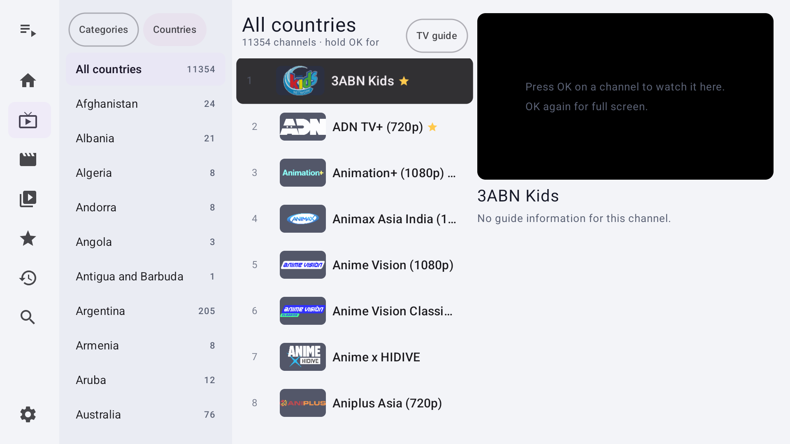    |   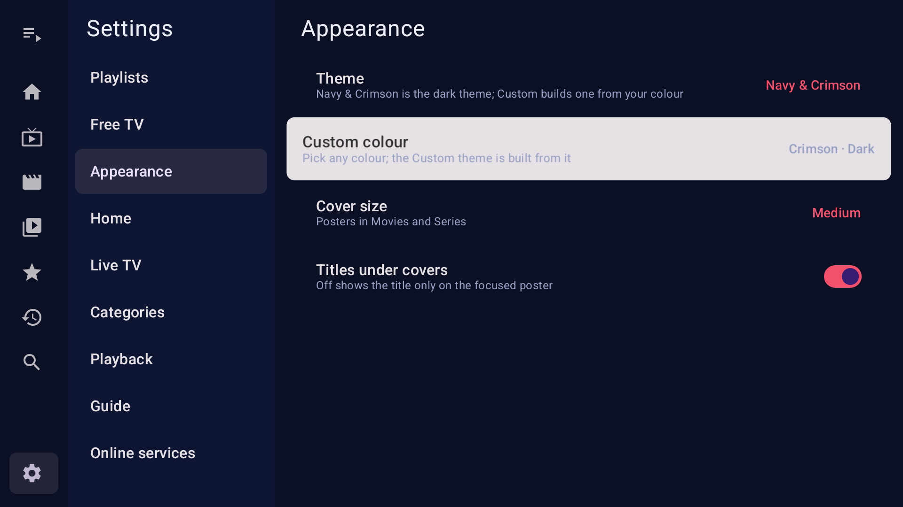           |
|                                    Android TV: Custom theme colour picker                                   |                   Windows: Home with Continue watching                |
|            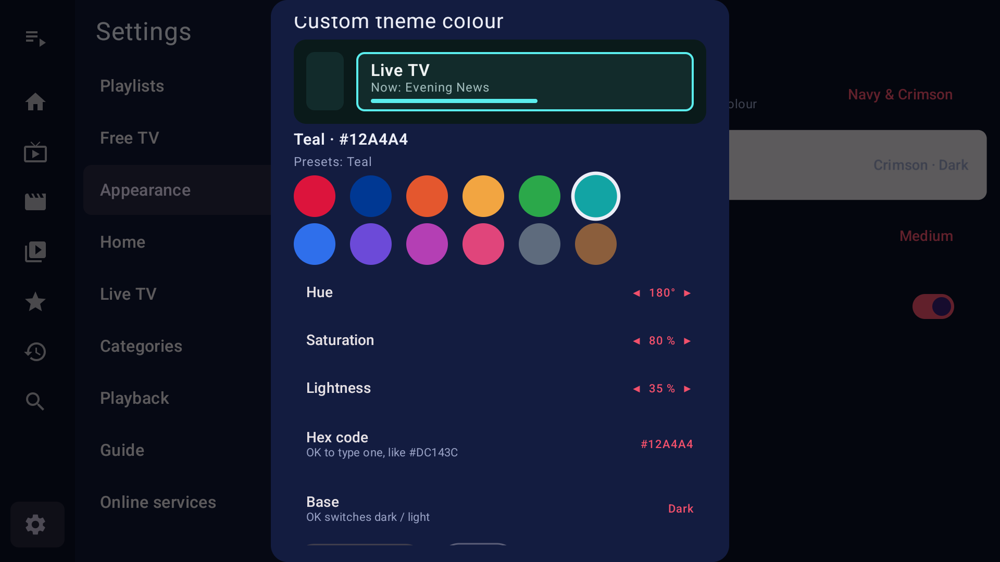                  |   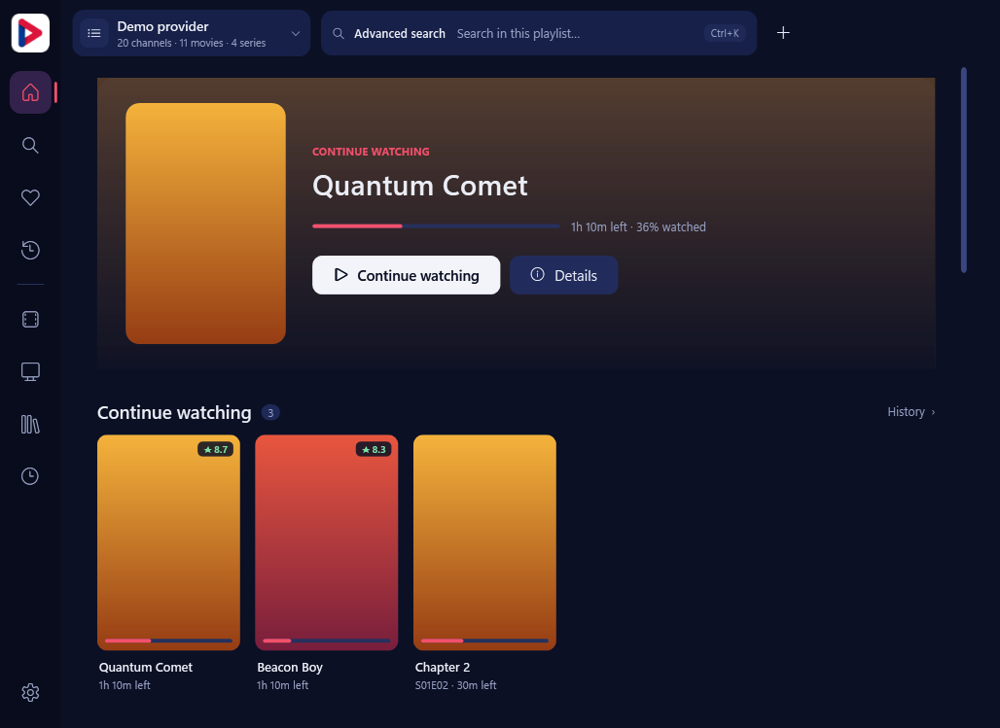 |
|                                Windows: Live TV with guide timeline                                         |                     Windows: Movies with sort and rating filter        |
|          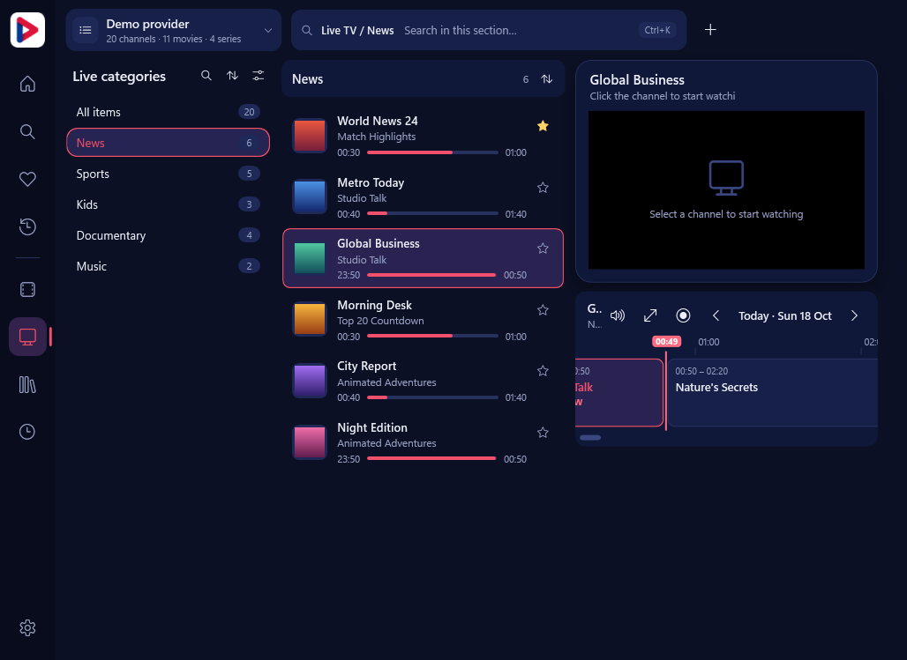            |   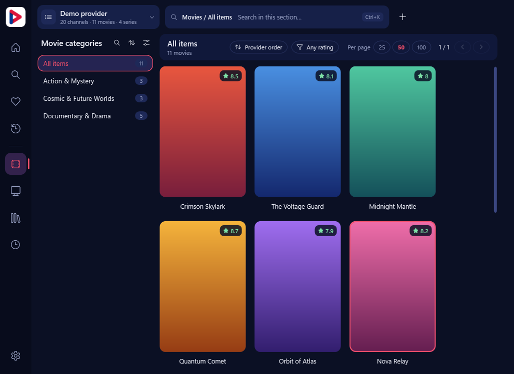        |
|                                Windows: Series with seasons and episodes                                    |                     Windows: Search across everything                  |
|            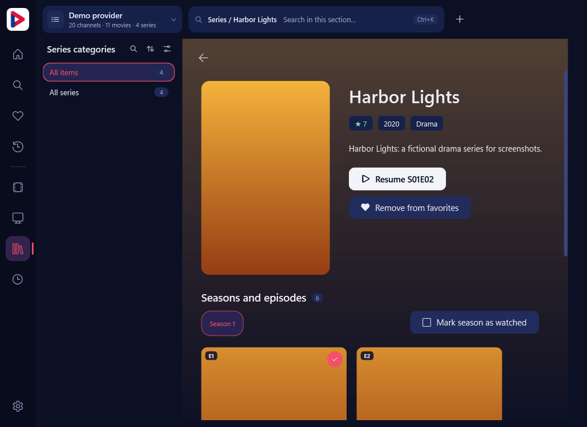                     |   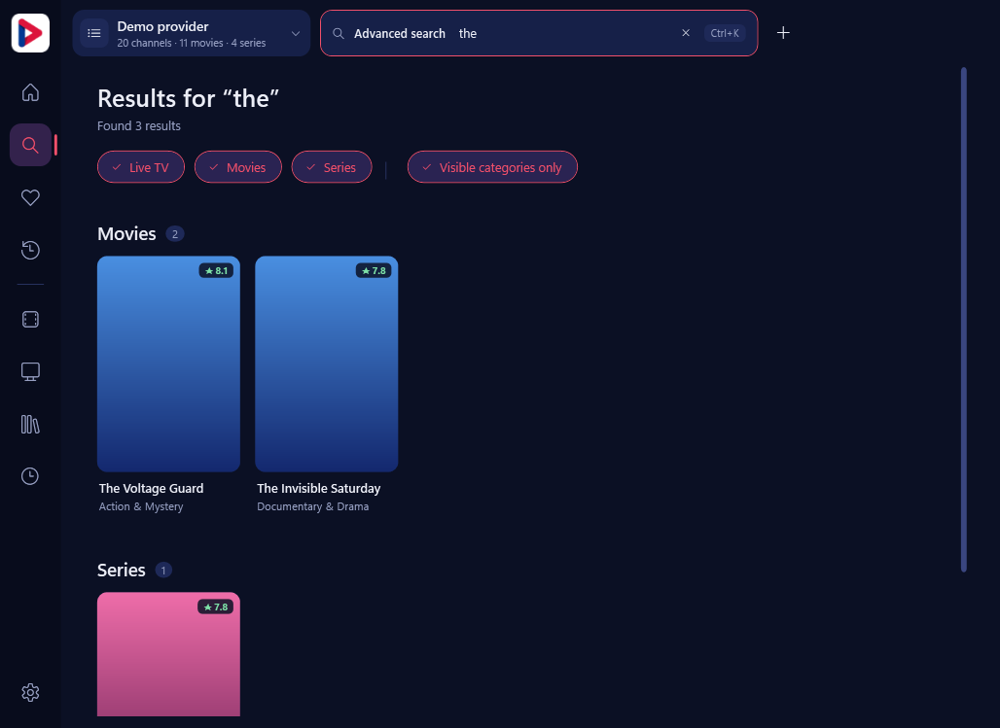             |
|                                Windows: Light theme                                                         |                     Windows: Custom theme (Teal)                      |
|               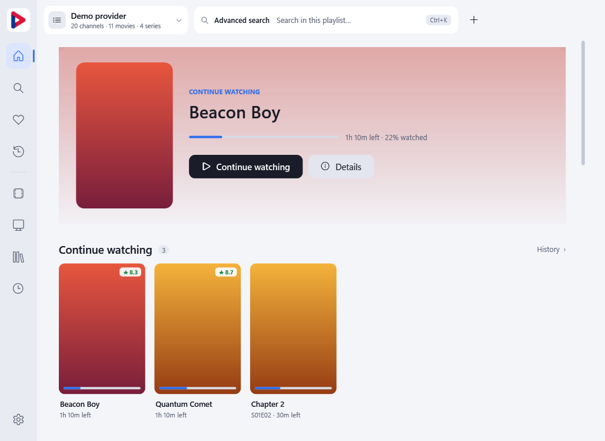                                   |   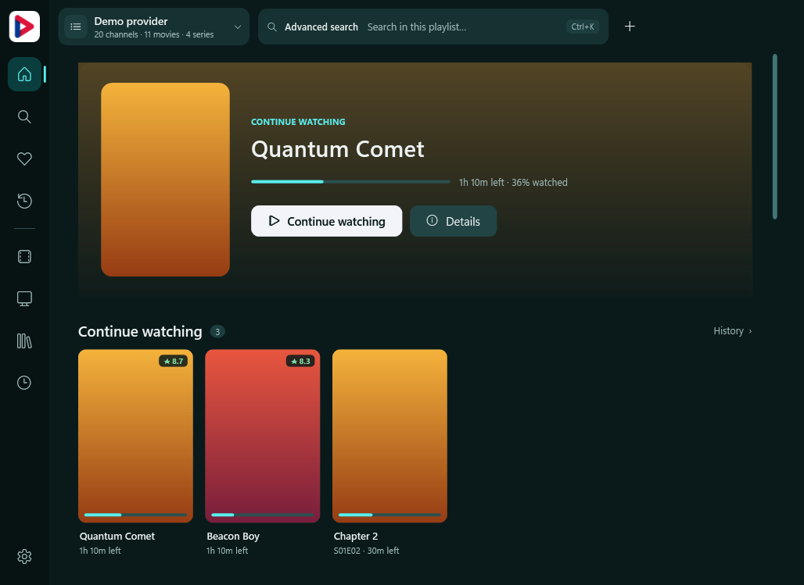 |

_Windows screenshots use made-up demo data rendered by CI._

## Support the project ☕

Madhyam is free and has no ads. If it's useful to you, you can support its development:

Bug reports and ideas are welcome in [Issues](https://github.com/diwaskhadka/Madhyam/issues).

## For developers

- **Engine:** a platform-independent IPTV engine in Rust (`crates/madhyam-core`), with M3U, XMLTV and Xtream Codes support and a 6-function C ABI. See [docs/ENGINE.md](docs/ENGINE.md) for the design, performance, layout and build steps, and [docs/API.md](docs/API.md) for every method.
- **Apps:** Android TV in [`android/`](android) (Kotlin, Compose for TV, Media3), and Windows in [`windows/`](windows) (WPF, LibVLC).
- **Releases:** [docs/RELEASING.md](docs/RELEASING.md) covers the shared version, the changelog, signing and adding a platform.
- **Branding:** the name, icon and colours are in [`branding/`](branding/README.md).

## License

MIT, see [LICENSE](LICENSE).
